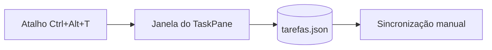

# Mecânica do GitHub: o que renderiza, o que é removido, como usar mídia

Esta é a parte do README com a evidência mais sólida: vem da documentação do GitHub e de testes feitos com `POST /markdown` (em 2026-10-11). O endpoint não reproduz exatamente o pipeline que renderiza o README em tela, então a lista de HTML permitido é empírica e pode mudar: prefira o subconjunto abaixo.

## Onde o arquivo vive e limites

- O GitHub procura o README em `.github/`, depois na raiz, depois em `docs/` (a primeira ocorrência vence).
- Conteúdo acima de **500 KiB** é truncado.
- O GitHub gera o **Outline** (sumário lateral) a partir dos títulos.
- Link relativo acompanha a branch (funciona em clone, fork e na árvore da branch). O GitHub é **sensível a maiúsculas**: `Docs/Img.PNG` ≠ `docs/img.png`, mesmo que funcione no Windows e no macOS.
- Imagem e GIF: até **10 MB**. Vídeo: até **10 MB** no plano gratuito e **100 MB** no pago.
- Social preview (imagem ao compartilhar o link): **1280×640**, abaixo de 1 MB (mínimo 640×320).
- About (descrição curta) e topics (até 20, minúsculas, hífen) são do repositório, não do README, e é neles que a busca do GitHub olha primeiro.

## HTML: o que fica e o que sai

| Fica | Sai (removido ou escapado) |
|---|---|
| `align`, `width`, `height`, `id` | atributos `style`, `class`, `target` |
| `<details>`, `<summary>`, `<picture>`, `<source>` | `<svg>` inline, `<center>`, `<font>`, `<u>`, `<small>` |
| `<kbd>`, `<sub>`, `<sup>`, `<br>`, `<p>`, `<div>`, ``, `<a>`, `<h1>`–`<h6>`, tabelas | formulários, `<iframe>`, `<script>`, `<style>` (viram texto) |

- Centralizar: `<p align="center">` ou `<div align="center">`. Nunca `<center>`.
- `<video>` bruto é removido em README de repositório. Para vídeo: arraste o arquivo no editor do GitHub (README, issue ou PR) e cole a URL `https://github.com/user-attachments/assets/<id>` **em linha própria**. Vídeo hospedado fora (YouTube) não renderiza: use link com thumbnail clicável.
- A skill não consegue gerar essa URL: deixe `<!-- PENDENTE: vídeo da demo (arrastar no editor do GitHub e colar a URL aqui) -->` ou use GIF versionado.

## Imagens

```markdown

```

```html

```

- Caminho relativo à raiz do repositório ou ao README, com a caixa exata do arquivo.
- Alt descritivo (o que a imagem mostra), sem começar por "imagem de". "Captura de tela de ..." está bem.
- `width` para não estourar a coluna (720 a 800 é seguro). Largura fixa ajuda quem tem tela estreita.
- Arquivos em `docs/img/` ou `assets/`; fora do `.gitignore`.
- Se o README também vai para **PyPI ou npm**: caminhos relativos não resolvem lá; use URL absoluta (`https://raw.githubusercontent.com/OWNER/REPO/BRANCH/docs/img/x.png`), e evite sintaxe só do GitHub (alertas, `<g-emoji>`, `:shortcode:`).

### Tema claro e escuro

```html
<picture>
  <source media="(prefers-color-scheme: dark)" srcset="docs/img/principal-escuro.png">
  <source media="(prefers-color-scheme: light)" srcset="docs/img/principal-claro.png">
  
</picture>
```

Os fragmentos `#gh-dark-mode-only` e `#gh-light-mode-only` estão depreciados na documentação arquivada (ainda funcionam no CSS do github.com, sem garantia). Gere `<picture>`; só reconheça `#gh-*` ao editar README antigo.

## Badges

- **3 a 5**, em uma linha, cada um respondendo a uma pergunta: funciona? (build), qual versão? (release), posso usar? (licença), está mantido? (último commit ou status). Teto 8. Sem vaidade (estrelas, "made with love").
- Só badge de algo que existe: sem workflow de CI, sem badge de build; sem pacote publicado, sem badge de registry.
- Alt significativo (`Licença MIT`, `Última versão`, `Build`).

```markdown
[](https://github.com/OWNER/REPO/releases)
[](LICENSE)
[](https://github.com/OWNER/REPO/actions/workflows/ARQUIVO.yml)
[](https://github.com/OWNER/REPO/releases)
[](https://pypi.org/project/PACOTE/)
[](https://www.npmjs.com/package/PACOTE)
```

- A rota antiga `shields.io/github/workflow/status/...` foi **aposentada** (2025-11-29): use `/github/actions/workflow/status/OWNER/REPO/ARQUIVO.yml` ou o badge nativo do GitHub (`.../actions/workflows/ARQUIVO.yml/badge.svg`).
- Badge nativo de workflow não aparece para repositório privado.
- O parâmetro `link` do shields só funciona dentro de `<object>`, não em Markdown: envolva a imagem em `[](destino)`.
- Badge estático local (arquivo no repositório) evita requisição externa; a standard-readme prefere isso para badges que não mudam.

## Alertas, detalhes, tabelas

```markdown
> [!NOTE]
> Informação útil que o leitor deve saber, mesmo lendo na diagonal.

> [!WARNING]
> Algo que pode causar problema.
```

Tipos: `NOTE`, `TIP`, `IMPORTANT`, `WARNING`, `CAUTION`. **No máximo 1 ou 2 por documento**, sem aninhar; muitos alertas anulam a atenção.

```html
<details>
<summary>O Windows mostrou "O Windows protegeu seu computador"</summary>

Conteúdo em Markdown (deixe uma linha em branco depois de `</summary>`).

</details>
```

Use `<details>` para conteúdo **secundário** (solução de problemas, instalação alternativa), nunca para o caminho principal.

Tabelas: cabeçalho obrigatório; alinhe com `:---`, `:---:`. Para comparação, 3 a 5 linhas.

## Diagramas (Mermaid)

O GitHub renderiza Mermaid em bloco cercado com ```` ```mermaid ````. GeoJSON/TopoJSON e STL também.

Quando usar: há **3 ou mais componentes** ou relações não lineares que o texto obrigaria o leitor a reconstruir (fluxo de dados, arquitetura, sequência de chamadas). Se couber em duas frases, não faça diagrama. Nenhum dos 38 READMEs lidos usava Mermaid: é diferencial, não obrigação.

````markdown

````

- Prefira tipos clássicos: `flowchart`, `sequenceDiagram`, `classDiagram`, `stateDiagram-v2`, `erDiagram`, `gantt`, `pie`. Tipos `-beta` mudam.
- `zenuml` não é suportado.
- Dê o **equivalente em texto** logo abaixo ou antes (uma frase), para quem usa leitor de tela e para PyPI/npm, que não renderizam Mermaid.
- Não ponha informação crítica só no diagrama.

## Demo de CLI

Grave com **VHS** (arquivo `.tape` versionado, reproduzível):

```
Output docs/img/demo.gif
Set FontSize 18
Set Width 900
Set Height 480
Type "mycli buscar 'erro' ./logs"
Enter
Sleep 3s
```

Gere com `vhs demo.tape` e referencie o GIF. Mantenha o clipe curto (cerca de 5 s ou menos), sem texto sobreposto, e repita o comando e a saída em texto abaixo. asciinema só entra como imagem SVG com link para a gravação (README não executa JavaScript).

## Acessibilidade

Sem estudo empírico específico de README; valem por serem guias e normas (GitHub, WCAG 2.2).

1. **Um H1** e níveis em ordem (não pule de `##` para `####`).
2. **Alt** curto e descritivo em toda imagem que carrega informação; badge com alt útil.
3. **Links descritivos**: "Guia de instalação", nunca "clique aqui".
4. Listas e tabelas em Markdown de verdade, não texto alinhado com espaços.
5. Nada transmitido **só por cor ou emoji**; emoji com a palavra ao lado (leitores de tela leem o nome do emoji).
6. Contraste mínimo 4,5:1 em imagens com texto; GIF ou vídeo com movimento automático acima de 5 s precisa de forma de pausar (daí GIFs curtos e vídeo com controles).

## Sumário (TOC)

O GitHub gera o Outline automaticamente. Sumário manual vale para arquivo com mais de ~100 linhas ou quando o README também sai em PyPI/npm. Âncora do GitHub: título em minúsculas, sem pontuação, espaços viram `-` (`## Início rápido` → `#início-rápido`); títulos repetidos ganham `-1`, `-2`.
